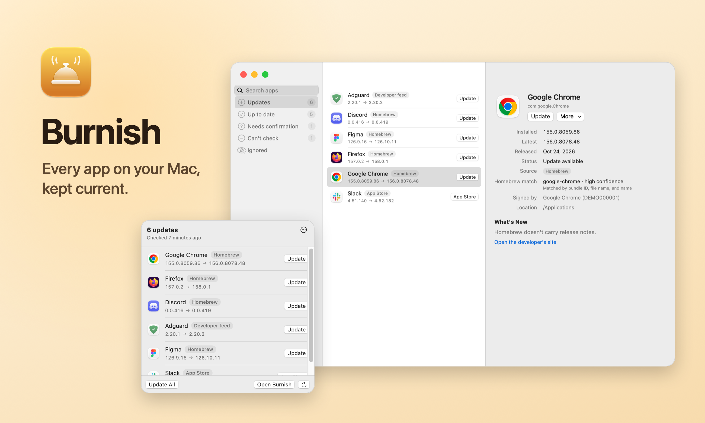

<p align="center">
  <picture>
    <source media="(prefers-color-scheme: dark)" srcset="docs/images/showcase-dark.png">
    
  </picture>
</p>

<p align="center">
  <a href="https://github.com/EnigmaticZee/Burnish/releases/latest/download/Burnish.dmg"><b>Download Burnish for Mac</b></a>
  &nbsp;·&nbsp; <a href="https://enigmaticzee.github.io/Burnish/">Website</a>
  &nbsp;·&nbsp; free &nbsp;·&nbsp; macOS 14+ &nbsp;·&nbsp; Apple silicon &amp; Intel
</p>

<p align="center">
  <a href="https://github.com/EnigmaticZee/Burnish/releases"></a>
  
  
  
  <a href="LICENSE"></a>
</p>

> [!NOTE]
> **Burnish is in beta.** Detection has been tested on a handful of Macs, not hundreds. It's careful by design (it would rather say "can't check" than guess), but if it ever matches an app to the wrong thing, **Wrong Match? → Report a Wrong Match on GitHub** in the app opens a ready-made issue.

## Why Burnish

Most Macs collect apps from everywhere: direct downloads, the App Store, Homebrew. Keeping all of them current means visiting a dozen update windows, or trusting an updater that guesses. Burnish does it properly, from your menu bar.

- **It finds updates for apps from anywhere.** Each app is checked against the best source it has: its developer's own update feed first, the App Store for App Store apps, and Homebrew's public app list for everything else, however the app was installed.
- **It never guesses.** When Burnish isn't sure which app is which, it asks under *Needs confirmation* instead of raising a false alarm. Anything it can't check says why.
- **It updates like a careful person would.** Every download is checked before anything changes, apps are asked politely to quit, and the old version goes to the Trash, so nothing is ever lost.

## What it checks

| Source | How Burnish recognises it | Where the latest version comes from |
| --- | --- | --- |
| Mac App Store | The App Store receipt inside the app | Apple's public lookup, batched by bundle ID |
| Sparkle | `SUFeedURL` in the app's Info.plist | The developer's appcast |
| Electron | `app-update.yml` inside the app | The developer's `latest-mac.yml` |
| Tauri | The updater address compiled into the app | The developer's update server; the app installs it, checking its own signature |
| Homebrew | Matched to Homebrew's cask list by bundle ID, file name and name | `formulae.brew.sh` |
| GitHub Releases | A Homebrew download hosted on GitHub | The newest stable release |

Homebrew's data has no bundle IDs to join on, so Burnish scores every candidate. A match only raises an alert when a bundle ID and the app's name agree, or the file name and display name both match. When several versions of one app share a bundle ID (stable, beta, ESR), the one whose version line fits the installed copy wins, and a tie means Burnish asks you.

Some apps are meant to be updated by their developer's own tool: Microsoft AutoUpdate for Office and Teams, Adobe Creative Cloud, Setapp for apps installed through it, JetBrains Toolbox for its IDEs. When that tool is on your Mac, Burnish's **Update** opens it instead of downloading anything, and **Update All** opens each one once.

Apps you installed with `brew install --cask` show as **Managed by Homebrew**; Burnish leaves them to `brew upgrade` unless you turn on Homebrew updates in Settings, so the two never fight.

## Eight promises

Burnish replaces other apps on your Mac, so every install keeps all eight of these, or it doesn't happen and you get the developer's download page instead:

1. **Only trusted sources.** The download comes from the app's own update feed or Homebrew's data, over HTTPS.
2. **The developer's signature.** If the app pins a Sparkle signing key, the update must be signed with it.
3. **The published checksum.** If the source gives one, the file must match it exactly.
4. **The same developer.** The new copy must pass Gatekeeper and be signed by an Apple-issued certificate for the same team as the copy you have, with the same bundle ID. Apps without a developer signature are never replaced.
5. **No installer packages run on their own.** A verified `.pkg` opens in Apple's Installer, so you see every step.
6. **No force-quitting.** Burnish asks an app to quit and waits. If it has unsaved work, you decide.
7. **Nothing deleted.** The old version goes to the Trash; the new one takes its place and reopens if it was running. Changed your mind? **Put Back** returns the earlier version, after checking it the same way.
8. **Your password stays yours.** When a folder needs admin rights, macOS asks you itself.

Major upgrades (5.x → 6.x) are marked *May be paid* and never included in **Update All**.

## Where your data goes

No account, no analytics, no crash reports. Logs stay on your Mac. These are the only requests Burnish makes:

| Request | When | What it sends |
| --- | --- | --- |
| Homebrew's app list (`formulae.brew.sh`) | At most once a day | Nothing about your apps |
| Apple's App Store lookup (`itunes.apple.com`) | Each check, if you have App Store apps | Their bundle IDs (you can turn this off) |
| Each app's own update feed, and release-notes links in it | Each check | Nothing beyond the request |
| GitHub's releases API, for apps whose download lives on GitHub | Each check, cached | Nothing beyond the request |
| Community match fixes (this repository) | At most once a day (you can turn this off) | Nothing |
| The update download itself | When you update | Nothing beyond the request |
| Burnish's own update feed (this repository's releases) | About once a day | Nothing beyond the request |

macOS may also contact Apple when Burnish asks Gatekeeper to check a downloaded app, the same check that runs when you open anything you've downloaded.

## Install

1. **[Download Burnish.dmg](https://github.com/EnigmaticZee/Burnish/releases/latest/download/Burnish.dmg)**, open it and drag Burnish into Applications.
2. **Open it once.** Burnish isn't notarised by Apple yet (that needs a paid developer account), so macOS blocks it the first time. Click **Done**.
3. **Allow it.** In **System Settings → Privacy & Security**, next to *"Burnish" was blocked*, click **Open Anyway**.
4. **Let it update apps.** Burnish asks for **App Management** (System Settings → Privacy & Security), which macOS requires before one app can replace another. Finding updates works without it.

<details>
<summary>Prefer Terminal? Skip steps 2–3</summary>
<br>

This removes the "downloaded from the internet" flag for Burnish only:

```sh
xattr -dr com.apple.quarantine /Applications/Burnish.app
```

</details>

From then on Burnish lives in your menu bar, checks once a day, and updates itself.

## FAQ

<details>
<summary><b>Is it safe to let an app replace other apps?</b></summary>
<br>
That's what the <a href="#eight-promises">eight promises</a> are for. Every check runs before the installed app is touched, against the app as it is on disk at that moment, and each one has an automated test that feeds it a bad file and proves the install is refused. The old version always goes to the Trash.
</details>

<details>
<summary><b>Will it fight with Homebrew?</b></summary>
<br>
No. Apps installed with Homebrew are shown but left to <code>brew upgrade</code>, unless you turn on <b>Update with brew upgrade</b> in Settings.
</details>

<details>
<summary><b>What about App Store apps?</b></summary>
<br>
Burnish finds their updates and hands them to the App Store, which installs them: one update opens its page, and several open the App Store's Updates page so Apple's <b>Update All</b> does them in one go. Burnish's own <b>Update All</b> does that hand-off for you after its own installs. It doesn't use private Apple APIs.
</details>

<details>
<summary><b>Why does it say "Can't check" for some apps?</b></summary>
<br>
Some apps have no public update source Burnish can read, or set their update feed only while running. Burnish says so rather than guessing. If an app is in Homebrew under a different name, <b>Wrong Match? → Choose a Different Homebrew App</b> fixes it for you, and <a href="overrides/README.md">community match fixes</a> fix it for everyone. Know where an app announces its updates? Add it to the <a href="overrides/README.md#update-feeds">community feeds</a> and Burnish can watch it for everyone.
</details>

<details>
<summary><b>Does it update macOS?</b></summary>
<br>
No. Apple's Software Update handles macOS and Apple's own apps.
</details>

## From the command line

The `burnish` tool ships inside the app and uses the same engine:

```sh
B=/Applications/Burnish.app/Contents/Helpers/burnish
$B check                 # every app's status; add --csv or --json
$B count                 # how many updates are waiting (--cached answers instantly)
$B update Firefox        # one verified install
$B restore Firefox       # put back the version that update replaced
$B history Firefox       # what Burnish has done with an app
$B inventory             # every app with bundle ID, versions, Team ID and update hints
```

## For IT admins

Settings can be enforced with a configuration profile, and the bundled `burnish` tool produces
JSON and CSV reports. [docs/ADMINS.md](docs/ADMINS.md) has every key and an example.

## Shortcuts

- **Open URL** with `burnish://check`, `burnish://update-all` or `burnish://open` runs a check,
  updates everything Burnish can install, or opens the window.
- **Run Shell Script** with `/Applications/Burnish.app/Contents/Helpers/burnish count` gives you the
  number of updates waiting, for widgets, Focus filters or a morning summary.
- The daily notification has an **Update All** button too.

## Roadmap

**In the beta**

✅ Updates from the App Store, Sparkle, Electron, Homebrew and GitHub<br>
✅ Safe one-click and Update All installs, with the old version kept in the Trash<br>
✅ Ignore a version or an app, and correct a match<br>
✅ Put back the version an update replaced, and a history for every app<br>
✅ A desktop widget with the update count and the first three apps<br>
✅ Daily check with at most one notification a day<br>
✅ Burnish updates itself

**Next**

⬜ Signed and notarised builds, so there's no first-launch prompt<br>
⬜ A Homebrew cask for Burnish<br>
⬜ More apps matched out of the box

## Build from source

```sh
git clone https://github.com/EnigmaticZee/Burnish.git && cd Burnish
scripts/test.sh              # run the tests
scripts/build-app.sh         # build/Burnish.app
open build/Burnish.app
```

SwiftUI's macros ship with Xcode, so have Xcode installed; the scripts find it on their own. See [docs/DEVELOPMENT.md](docs/DEVELOPMENT.md) for how the project is put together and the rules every change follows.

**Contributing:** issues and pull requests are welcome. The fastest way to help is fixing a wrong match in [overrides/community-overrides.json](overrides/README.md).

---

<p align="center">
  Made by <b>Zee</b> · <a href="LICENSE">MIT License</a> · Updates by <a href="https://sparkle-project.org">Sparkle</a>
</p>
